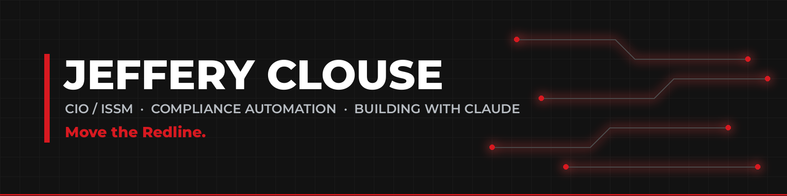

### I engineer the systems that keep healthcare IT running, secure and compliant.

22+ years in military healthcare IT, from patient records and medical logistics to CIO and ISSM. I know how the whole facility works, and I build tools that remove the friction from it. Founder of **[Redline Tech Solutions](https://redlinetechsolutions.org/)**: automation, AI-assisted development and compliance tooling.

### What I build

- **Compliance automation:** PowerShell remediation for ACAS and STIG findings, RMF and eMASS tooling, repeatable fix actions instead of one-off patches
- **Fleet operations:** scripts, dashboards and trackers for enterprise Windows 11 environments
- **Built with Claude:** apps, Claude Code plugins and skills, and one very busy watch face

### Featured projects

| Project | What it does |
|---|---|
| [**clawd-watch-face**](https://github.com/JeffClouse77/clawd-watch-face) | Clawd as a living Galaxy Watch face: daily schedule, health moods, weather, calendar surprises. Built end to end in one Claude Code session, no Android Studio. |
| [**claudetron**](https://github.com/JeffClouse77/claudetron) | A retro CRT TV for Claude. Type `/tv` and it plays the newest Claude and Atlanta sports videos in a pane while you work. |

### Toolbox

`PowerShell` `Python` `TypeScript` `Claude Code` `MECM` `ACAS` `STIG / SCAP` `RMF / eMASS` `Watch Face Format`

### Operating principles

Automate the second time. Document the hard lessons so the next person starts ahead. Ship, then sharpen.

---

Move the Redline. · <a href="https://redlinetechsolutions.org/">redlinetechsolutions.org</a>
